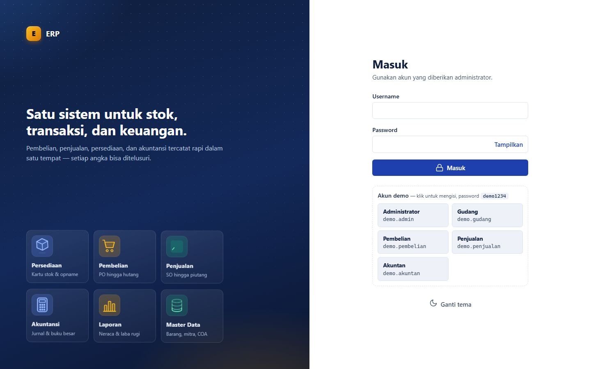
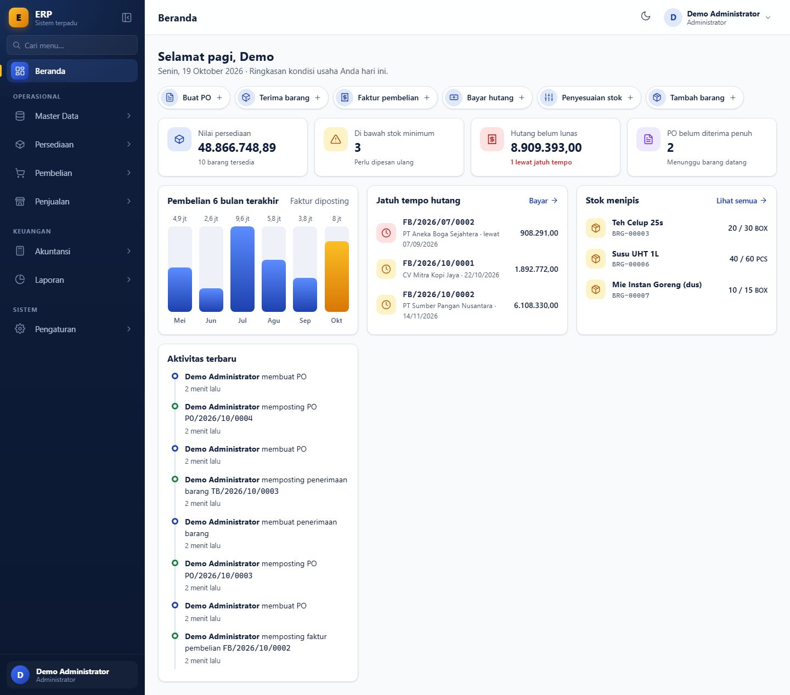
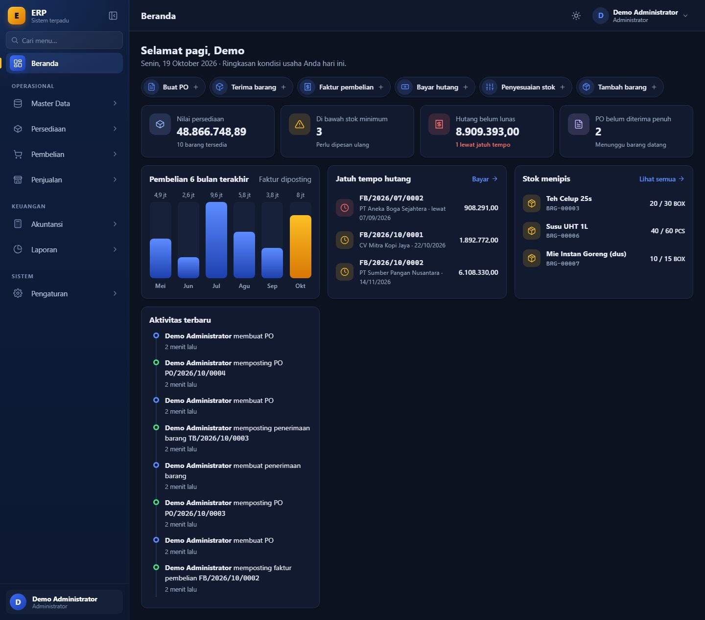
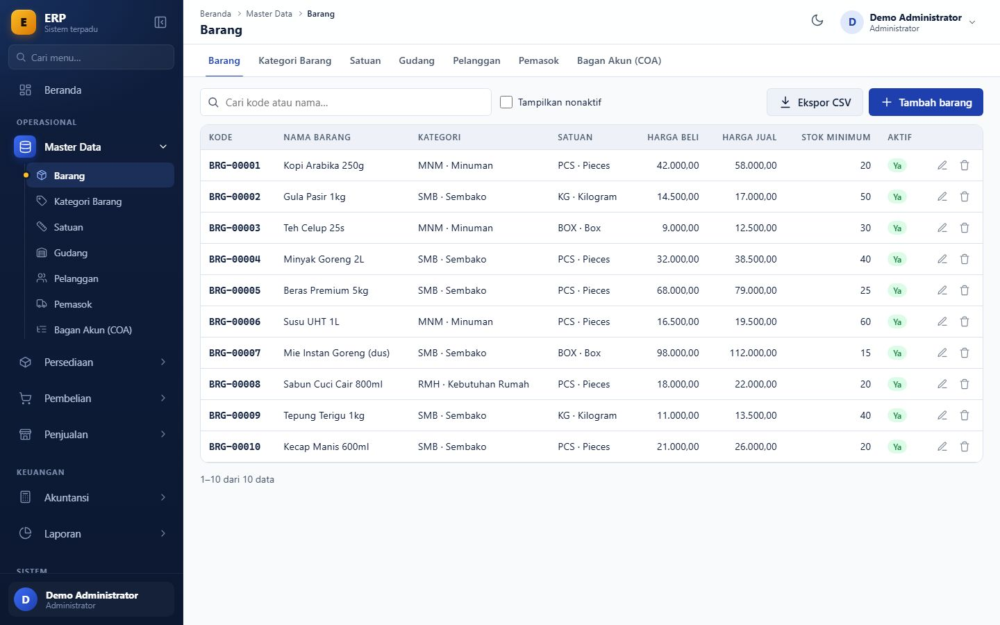
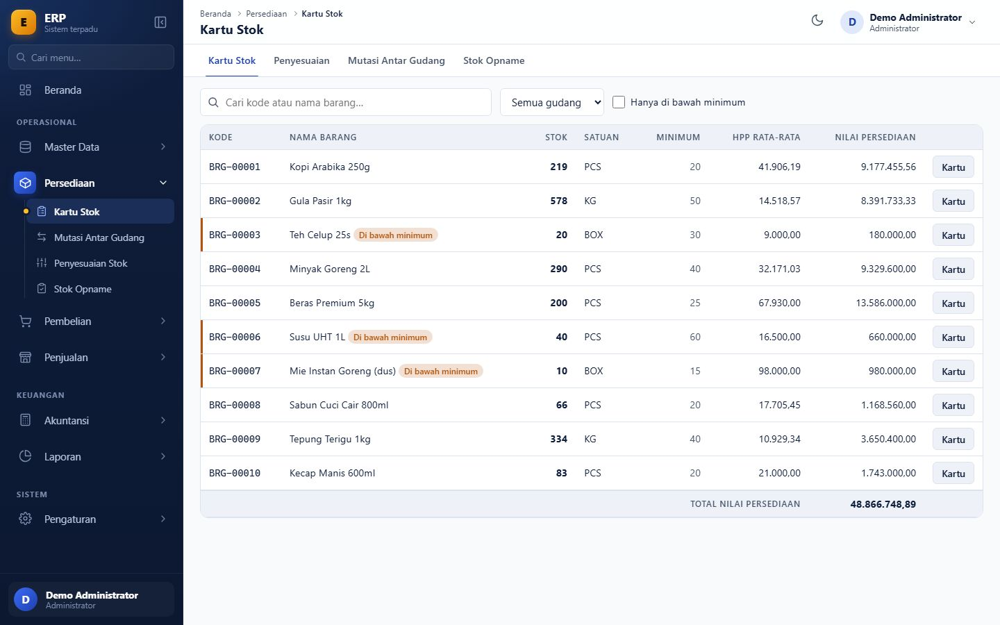
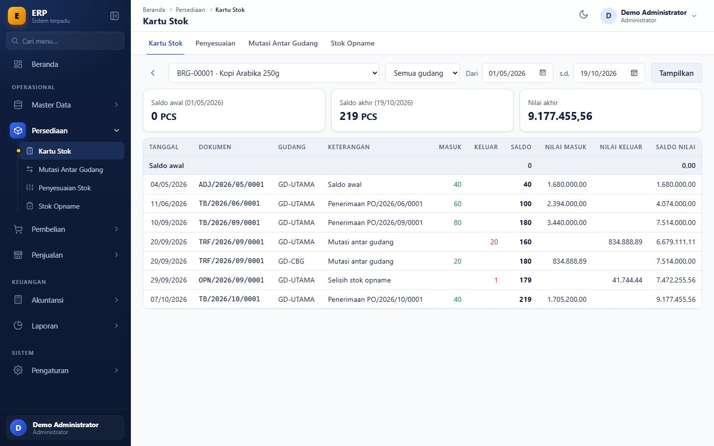
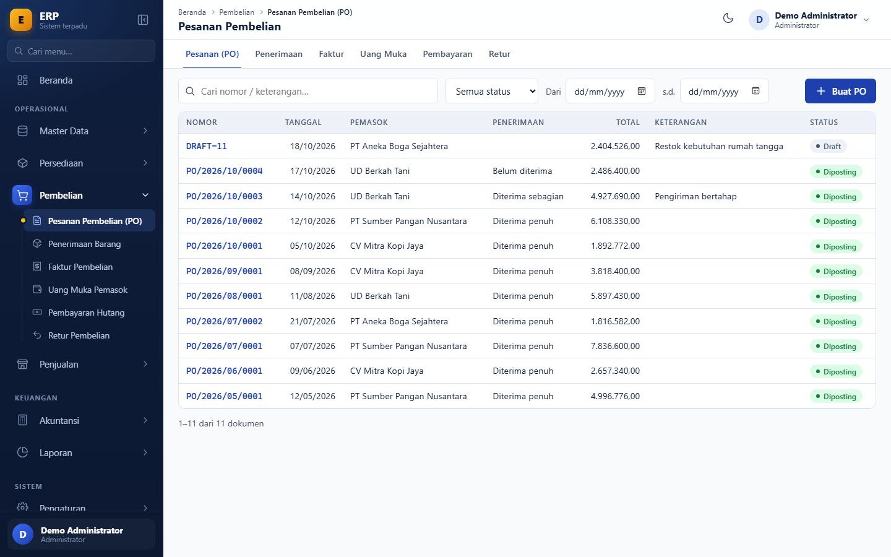
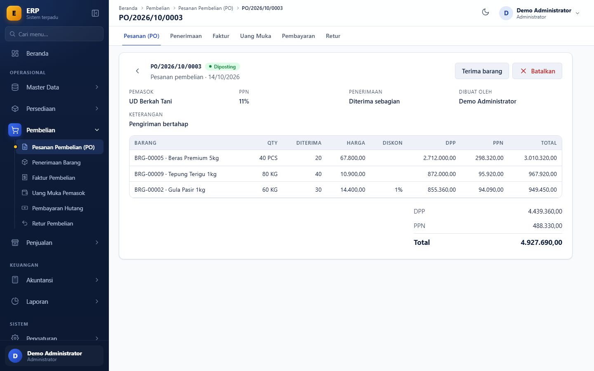
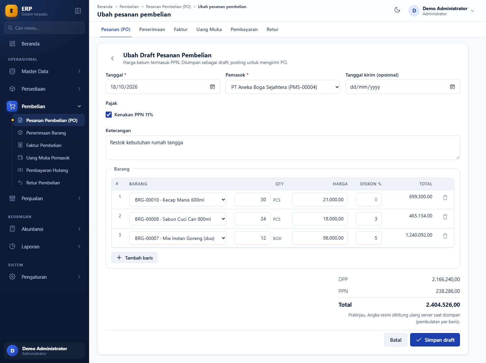
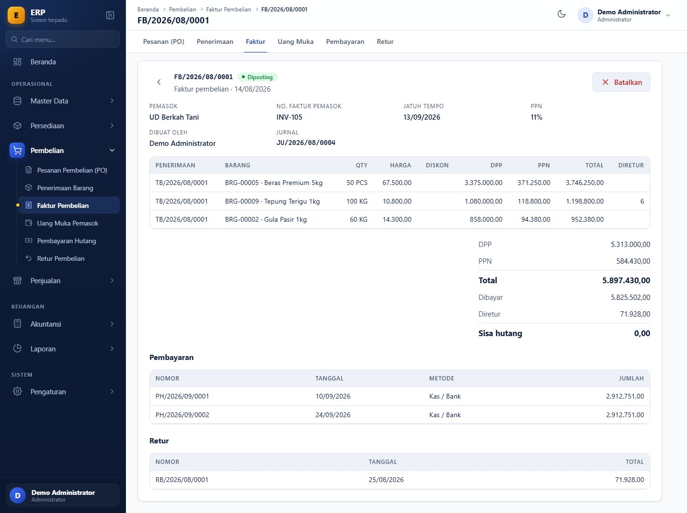

# ERP Ringkas

Aplikasi ERP berbahasa Indonesia untuk usaha dagang: **master data, persediaan, pembelian, dan jurnal akuntansi otomatis** dalam satu sistem yang ringan. Dibangun dengan Node.js + Express + EJS + HTMX + PostgreSQL, **tanpa tahap build**, tanpa ORM, dan hanya 9 dependency (`node_modules` sekitar 4 MB).

Semua angka uang disimpan sebagai `NUMERIC` dan dihitung dengan SQL atau bilangan bulat (BigInt), tidak pernah float JavaScript, sehingga laporan keuangan tidak bergeser satu sen pun.



## Tangkapan layar

Semua gambar di bawah diambil dari data demo (bukan data sungguhan).

### Beranda

Ringkasan kondisi usaha: nilai persediaan, stok di bawah minimum, hutang yang belum lunas (lengkap dengan peringatan lewat jatuh tempo), PO yang belum diterima penuh, grafik pembelian 6 bulan, dan aktivitas terbaru. Tersedia mode terang dan gelap.

| Mode terang | Mode gelap |
|---|---|
|  |  |

### Master data dan persediaan

| Master barang | Ringkasan stok |
|---|---|
|  |  |

Setiap barang masuk dan keluar tercatat di **kartu stok** dengan saldo berjalan (qty dan nilai). Nilai persediaan dihitung dengan metode **rata-rata bergerak**.



### Pembelian

Alur lengkap: **Pesanan (PO) → Penerimaan barang → Faktur → Uang muka → Pembayaran hutang → Retur**. Total DPP, PPN, dan grand total langsung terlihat saat mengetik.

| Daftar PO | PO diterima sebagian |
|---|---|
|  |  |

| Form PO dengan pratinjau total | Faktur dengan pembayaran dan retur |
|---|---|
|  |  |

## Fitur

| Modul | Status | Isi |
|---|---|---|
| Login dan hak akses | Selesai | JWT di signed cookie, bcrypt, proteksi CSRF, pembatas percobaan login, izin per peran × modul × aksi (diperiksa di middleware **dan** service) |
| Master data | Selesai | Barang, kategori, satuan, gudang, pelanggan, pemasok, bagan akun (template 49 akun UKM); kode otomatis, soft delete, ekspor CSV |
| Persediaan | Selesai | Kartu stok, penyesuaian (saldo awal/masuk/keluar), mutasi antar gudang, stok opname |
| Pembelian | Selesai | PO, penerimaan barang, faktur, uang muka, pembayaran hutang, retur |
| Mesin jurnal | Selesai | Jurnal berpasangan otomatis dari setiap dokumen, jurnal pembalik saat pembatalan |
| Penjualan | Belum | Penawaran, SO, surat jalan, faktur, penerimaan piutang |
| Akuntansi (tampilan) | Belum | Jurnal umum, buku besar, kas & bank, tutup periode (mesinnya sudah ada) |
| Laporan | Belum | Neraca, laba rugi, umur piutang/hutang, laporan stok/penjualan/pembelian |
| Pengaturan | Belum | Kelola pengguna, peran, dan tarif pajak lewat tampilan |
| Cetak PDF, worker terjadwal | Belum | `pdfmake` dan `node-cron` belum dipasang |

## Aturan bisnis yang diterapkan

- **Penilaian persediaan:** rata-rata bergerak per barang (global semua gudang). Saat stok habis, sisa nilai ikut dinolkan sehingga tidak ada sisa sen.
- **Pajak dan pembulatan:** PPN 11% (tarif tersimpan di tabel pengaturan), harga belum termasuk PPN, diskon % per baris, pembulatan half-up per baris ke rupiah penuh.
- **Status dokumen:** draft → diposting → batal. Dokumen yang sudah diposting tidak bisa diubah atau dihapus, hanya dibatalkan dengan stok dan jurnal pembalik. Pembatalan ditolak bila dokumen sudah dipakai dokumen lain (misalnya faktur yang sudah dibayar).
- **Jurnal:** total debit harus sama dengan total kredit. Dicek di aplikasi dan sekali lagi oleh trigger database saat `COMMIT`. Jurnal dan kartu stok tidak bisa di-`UPDATE` atau `DELETE`.
- **Stok:** angka stok tidak pernah diubah langsung, selalu lewat mutasi dalam satu transaksi. Stok negatif dan tanggal mundur ditolak.
- **Nomor dokumen:** `PO/2026/10/0001`, berurutan per jenis per bulan, dibuat dengan `SELECT ... FOR UPDATE` sehingga tidak pernah ganda. Nomor tidak terpakai bila transaksi gagal.
- **Tutup periode:** transaksi di periode yang sudah ditutup ditolak.
- **Jejak audit:** siapa, kapan, dan apa yang berubah dicatat untuk setiap dokumen.

## Teknologi

| Lapisan | Pilihan |
|---|---|
| Runtime | Node.js 20 atau lebih baru |
| Server | Express 4 |
| Tampilan | EJS (render di server) + HTMX + Alpine.js, CSS tulisan tangan, ikon SVG inline |
| Database | PostgreSQL, akses lewat `pg` dengan SQL murni (tanpa ORM) |
| Migrasi | File SQL bernomor + `scripts/migrate.js` |
| Keamanan | `helmet`, CSRF double-submit, bcryptjs, signed cookie |
| Tes | `node:test` bawaan Node (tanpa devDependencies) |

## Menjalankan di komputer sendiri

Prasyarat: **Node.js 20+** dan **PostgreSQL**. Perintah di bawah untuk Windows PowerShell.

```powershell
# 1. Pasang dependency
npm install --omit=dev

# 2. Buat dua database: satu untuk aplikasi, satu untuk tes (nama tes wajib berakhiran _tes)
createdb -U postgres erp
createdb -U postgres erp_tes

# 3. Siapkan konfigurasi, lalu isi password PostgreSQL dan rahasia acak di .env
Copy-Item .env.example .env
notepad .env

# 4. Buat tabel, akun admin, dan (opsional) akun demo
npm run migrate
node scripts/seed.js admin "PasswordKuat123"
npm run seed:demo

# 5. Jalankan (restart otomatis saat file berubah)
npm run dev
```

Buka http://localhost:3000. Setelah `npm run seed:demo`, halaman login menampilkan daftar akun demo yang bisa diklik. Satu akun per peran: Administrator, Gudang, Pembelian, Penjualan, dan Akuntan, semuanya dengan password `demo1234`. **Daftar ini hanya muncul di luar mode produksi.**

> Jangan pernah menaruh password asli di `.env.example`. File itu ikut tersimpan di git. Password hanya ditulis di `.env`, yang sudah masuk `.gitignore`.

## Tes

```powershell
npm test
```

Menjalankan seluruh tes: perhitungan angka dan pajak, keseimbangan jurnal, kartu stok dan saldo, rata-rata bergerak, nomor dokumen (termasuk saat bersamaan), tutup periode, alur pembelian dari PO sampai retur, pembatalan berantai, dan hak akses. Tes yang memakai database berjalan di `DATABASE_URL_TES`, yang dikosongkan setiap kali dijalankan. Aplikasi menolak menjalankan tes bila nama database tidak berakhiran `_tes`.

## Struktur folder

```
migrations/     File SQL bernomor (001_init … 004_pembelian)
scripts/        migrate.js, seed.js, seed-demo.js
src/
  app.js, server.js
  config/       db.js (helper transaksi), env.js
  lib/          angka, uang, pajak, csv, menu, akses
  middleware/   auth, akses, csrf, pesan, error
  modules/      master, persediaan, pembelian, akuntansi, pengaturan, beranda
                (controllers/, services/, routes.js; SQL hanya ada di services/)
  views/        EJS: partials/, dokumen/, master/, persediaan/, pembelian/, beranda/
public/         css/app.css, js/ (htmx, alpine, app.js)
tests/          node tests/run.js
docs/gambar/    Tangkapan layar untuk README
```

## Rencana berikutnya

1. Modul **Penjualan** (penawaran, SO, surat jalan, faktur, penerimaan piutang)
2. Tampilan **Akuntansi** (jurnal umum, buku besar, kas & bank, tutup periode)
3. **Laporan** (neraca, laba rugi, umur piutang/hutang, laporan stok)
4. Cetak **PDF** dokumen dan **worker** terjadwal (pengingat jatuh tempo, stok minimum)
5. Halaman **Pengaturan** (pengguna, peran, tarif pajak)
